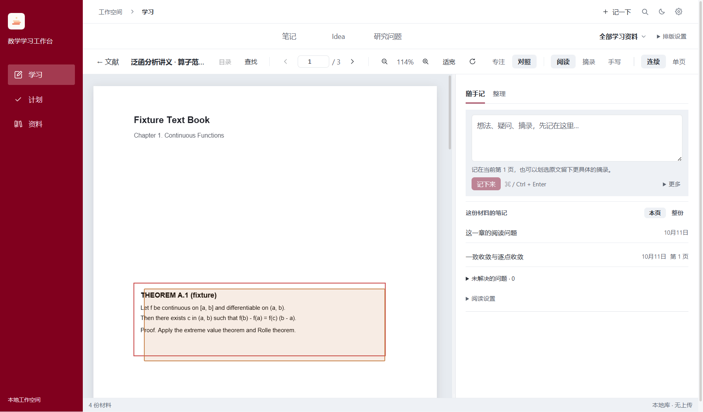
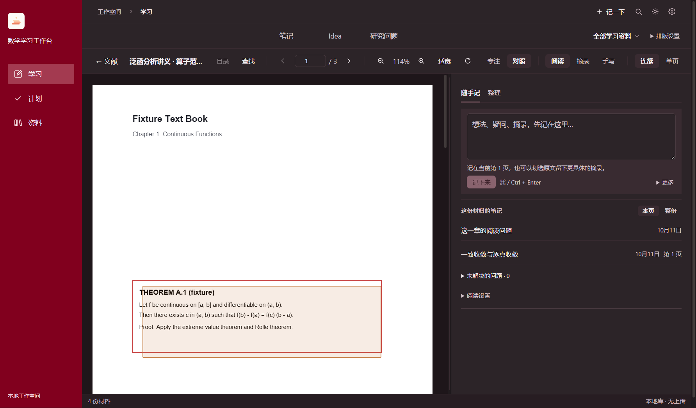
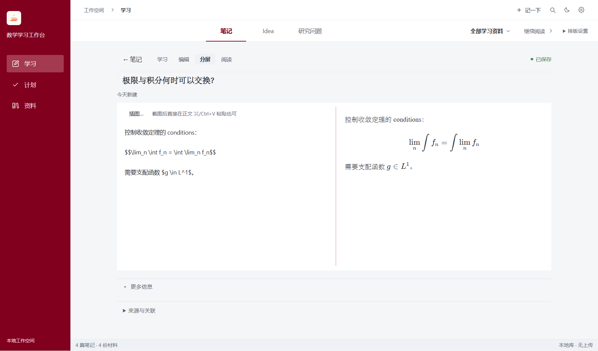
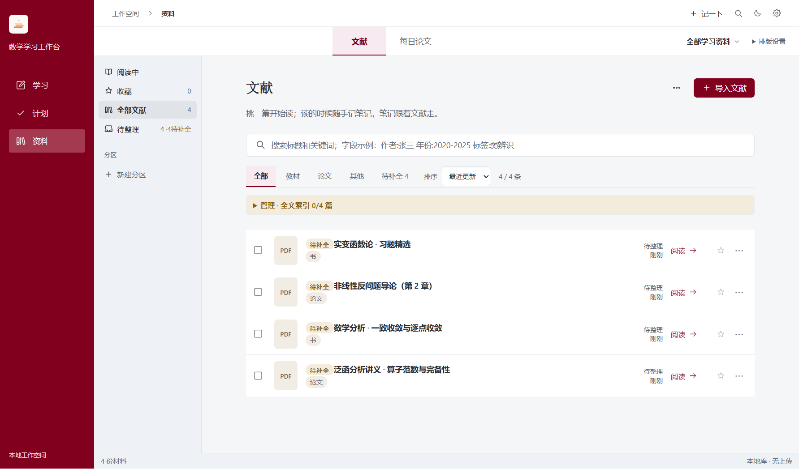
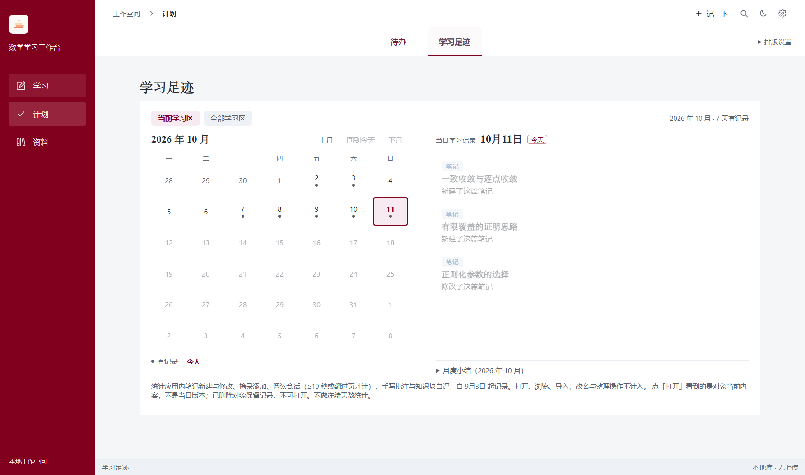

<div align="center">


# 渐知 · 科研学习工作台

**本地优先的科研学习工作台 —— 读文献、留可回溯的摘录、写会生长的笔记。**

> 渐知：取「渐知渐悟」之意——学问是一页一页读出来的。

*Jianzhi — a local-first research study workbench: read papers, excerpt with traceable anchors, and grow notes that keep up with you. Knowledge arrives gradually.*

[](LICENSE)


<br/>



*对照阅读：材料与笔记同一屏，写笔记不打断阅读。*

</div>

---

## 这是什么

渐知（Jianzhi）是一个跑在桌面上的**个人学习工作台**，为科研文献精读的场景设计：PDF 打开就能读，划选即成摘录且**永远能回到原文位置**，笔记用 Markdown + KaTeX，文献按你自己的分区组织。没有账号、没有云端——你的学习记录是一文件夹可读的文件，放在你自己的磁盘里。

界面当前为中文。

> **English**: Jianzhi (渐知， "gradual knowing") is a local-first desktop workbench for research reading. Read PDFs, excerpt with anchors that always trace back to the source, write Markdown + KaTeX notes, organize papers in your own sections, and review your progress on a learning calendar. No accounts, no cloud — your library is a folder of human-readable files on your own disk. UI is currently Chinese.

## 特性

### 📖 对照阅读 · 摘录可回溯

连续/单页阅读、目录与查找、缩放旋转；划选原文生成**摘录锚点**（坐标往返精度 <1e-6），点笔记里的「回原文 · 第 N 页」精确定位并闪烁提示。手写批注是旁侧覆盖层，**永不改写 PDF 原件**。

<p align="center"></p>

### ✍️ 笔记 · 公式 · Wiki

七种笔记类型、Markdown + KaTeX 公式、双链 Wiki、分屏编辑与实时预览、知识块学习视图（章节导航 + 自测先行）；文献笔记跟着文献走，独立笔记进你自己的知识库。

<p align="center"></p>

### 🗂️ 文献库 · 每日论文

分区与收藏、检索式搜索（`作者:张三 年份:2020-2025 标签:弱辨识`）、DOI/arXiv 自动识别、Zotero/BibTeX 导入、**浏览器扩展一键导入**；arXiv 订阅按关键词生成每日论文清单，看中的直接进文献库。

<p align="center"></p>

### 📅 学习日历

学习足迹以**月历**回看：哪天读了什么、写了什么、在哪里留下疑问，按材料/笔记归并、可直接点开；只有安静的记录，没有打卡和排行榜。

<p align="center"></p>

### 还有

- **对照工作空间**：材料 ∥ 笔记面板按比例分屏（默认 60:40），`Ctrl+\` 一键专注
- **速记 / 待办 / Idea**：全局快捷键随手记，`!` 开头变待办，想法可转笔记
- **研究问题**：以 problem 笔记为枢纽，聚合相关笔记、文献与知识块状态

## 设计原则

| 原则 | 含义 |
| --- | --- |
| **原件不可变** | PDF 与导入文件永不改写；批注、摘录、笔记全部存在旁侧文件里 |
| **文件即真相** | 库是一个文件夹：`entry.json`、`笔记/*.md`、`足迹.json`……人可读、可备份、可同步，删掉程序数据仍在 |
| **本地优先** | 无账号、无上传、无遥测；库目录放网盘即可在两台机器间同步（纯文件存储，无数据库） |

存储格式有完整规范：[docs/存储格式.md](docs/存储格式.md) · 架构与决策记录：[docs/architecture.md](docs/architecture.md)

## 安装

### 下载

从 [Releases](https://github.com/kh2657/jianzhi/releases) 下载 Windows 安装包（macOS 请从源码运行）。

### 从源码运行

```bash
git clone https://github.com/kh2657/jianzhi.git
cd studybench
npm install
npm run fixtures   # 首次必跑：生成测试夹具
npm run dev        # 热更新开发模式
```

要求 Node.js ≥ 23.6。正式打包：Windows `npm run update:win`，macOS `npm run install:mac`。

## 开发

```bash
npm run test:plan   # 按本次改动列出该跑哪些测试
npm run test:fast   # 只跑受影响的单元测试
npm run e2e:fast    # 渲染层改动后跑受影响的 E2E
npm run gate        # 交付前全量：typecheck + 398 单测 + 77 E2E
```

- 测试按反向依赖图**选测**（`scripts/affected-tests.mjs`），内核/共享区改动自动升级全量；pre-push 钩子与 GitHub Actions 双门禁
- 纯文件夹存储内核有完整单元测试；IPC 通道两侧一致性有漂移守卫测试

## 非目标

不做多设备账号同步、不做 OCR、不接模型 API、不做协作——这是单机个人工具，把「你的文件在你自己手里」做到底。

## 说明

本项目由人与 AI agent 按成文协作规范共同开发：设计先出可交互方案评审，实现遵循「失败测试先行 + 交付前全量门禁」，每个批次有如实的验收记录。

## License

[MIT](LICENSE)
